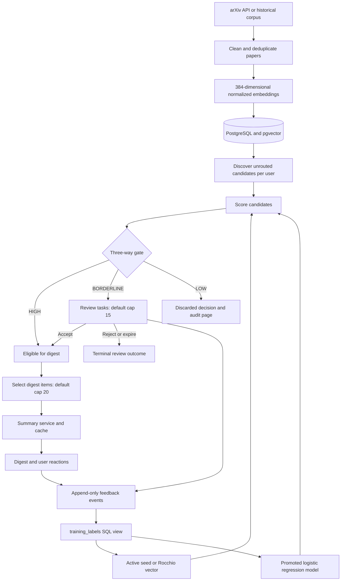

# Codebase, architecture, and workflow analysis

Historical pre-repair review. See [BACKEND_REPAIRS.md](BACKEND_REPAIRS.md) for subsequent fixes and current verification results.

Reviewed on 21 October 2026. This describes the working tree, including its existing uncommitted changes, rather than only the last Git commit. No application fixes were made during this review.

## Overall assessment

The project implements a substantial research-monitoring prototype: arXiv ingestion, semantic relevance gating, asynchronous review, summaries, feedback, adaptive preference learning, and offline/pilot evaluation. Its core design is understandable and appropriately modular. Several integration failures and evaluation-provenance problems prevent treating the current implementation as a validated production system or the paper's headline results as final evidence.

The highest priorities are the unauthenticated credential disclosure in onboarding, the digest lifecycle that loses later review acceptances, database bootstrap/loading failures, and evaluation code that converts missing human labels into negative ground truth.

## Review scope and verification limits

- Application: 44 Python files under `src/`, approximately 11,933 physical lines.
- Operations and experiments: 19 scripts, approximately 4,156 physical lines.
- Tests: 15 Python files, approximately 7,564 physical lines; reviewed coverage and assertions and executed the suite.
- Documentation: root README, both existing `docs/` documents, the implementation roadmap under `scratch/`, all five report Markdown documents, the Overleaf README, main document, ten section files, and bibliography.
- Inspected all eight HTML templates, configuration, dependency list, Docker Compose, saved result tables/JSON reports, and the local corpus/sample/label artifact structure.
- The Overleaf ZIP was inspected; its file contents match the corresponding extracted files.
- Dependency/vendor code inside `venv/`, Git internals, and every historical label-backup CSV were outside the application-source review. Bibliographic accuracy was not independently checked against external publications. The paper was read as source; it was not compiled or visually typeset during this analysis.
- The live database, arXiv service, Gemini API, hosted memory limits, and unattended scheduler were not exercised. Database observations below come from saved exports or isolated test databases, not a fresh production snapshot.

## Architecture

The system is a modular Python application with separate web and worker entry points sharing one SQLAlchemy data model. The “agent” is an explicit sequence of Python stages and persisted statuses. It does not use an autonomous LLM planner or a multi-agent framework.

This diagram describes the intended workflow. The current late-review and summary-retry failures are documented below.

### Runtime boundaries

| Runtime | Entry points | Responsibilities |
|---|---|---|
| Web service | `ui/app.py`, `scripts/run_ui.py` | Onboarding, token authentication, review actions, digest display, reactions, audit, health check |
| Daily worker | `scripts/run_daily_monitoring.py` | Fetch/embed papers, route per user, build queue/digest, evaluate vector/model updates; one-shot or daemon |
| Replay/core worker | `scripts/run_cycle.py` | Execute core state machine against stored papers; optional adaptation |
| Live ingestion worker | `scripts/run_phase8_live.py` | Fetch and route; does not itself perform the complete daily digest/adaptation workflow |
| Offline research tools | Sampling, labeling, Phase 4/12/13 scripts | Build evaluation data, calibrate thresholds, run experiments, export pilot data, collect surveys, generate figures |
| Database | PostgreSQL 16 and pgvector via Compose or configured URL | Shared paper store and user-specific workflow/memory records |

The web import path avoids PyTorch and SentenceTransformers; subprocess-based onboarding performs embedding separately. However, imports through package `__init__.py` files still pull in NumPy, pandas, and scikit-learn. The web application is not a completely independent minimal dependency distribution.

Docker Compose defines only PostgreSQL. There is no application Dockerfile or checked-in CI/scheduler workflow. Daemon support and scheduling instructions exist, but those do not establish that a scheduler is deployed.

### Module map

| Area | Files and responsibility |
|---|---|
| Configuration | `config.py`: environment-backed singleton settings and module-level aliases |
| Database | `models.py`: entities, relationships, constraints, effective-label view; `session.py`: engine, session contexts, initialization/migration SQL |
| Historical ingestion | `fetcher.py`: arXiv query/stream; `preprocessor.py`: ID cleaning, whitespace, withdrawn/empty filtering, deduplication |
| Embeddings/reference | `embedder.py`: cached SentenceTransformer and batch normalization; `reference_sample.py`: deterministic reference split and labeling-frame exclusion |
| Live ingestion | `live.py`: query construction, retries, DB deduplication, embedding only new records, ingestion telemetry, invocation of core pipeline |
| Relevance | `state.py`: pipeline containers/statuses; `router.py`: threshold boundaries; `thresholds.py`: reference percentiles, PostgreSQL calculation and artifact fallback |
| User memory | `user_manager.py`: user/profile/vector initialization; `preference.py`: Rocchio eligibility and versioned updates; `classifier.py`: classifier training, validation, promotion, thresholds, nearest-feedback explanations |
| Orchestration | `pipeline.py`: discovery, preprocessing, embedding attachment, scoring, routing, persistence, optional queue/adaptation calls |
| Human feedback | `review/queue.py`: review tasks/actions/expiry; `review/digest.py`: digest assembly and reactions; `review/labels.py`: effective-label reads |
| Summarization | `summary/summarizer.py`: provider interface, prompts, Gemini/mock implementations; `summary/service.py`: eligibility checks, cache, persistence, background entry point |
| Web UI | FastAPI routes, Jinja templates, HTMX fragments, inline CSS; server-rendered without a frontend build step |
| Evaluation foundation | `sampling.py`, `labeling.py`, `calibration.py`, `metrics.py`, `baselines.py`, `access.py` |
| Experiments | `simulation.py`, `experiments.py`: oracle protocols, baseline comparisons, learning curves, ablation, efficiency, review value |
| Pilot/final evaluation | `pilot_export.py`, `readiness.py`, `adaptation.py`, `survey.py`, `efficiency.py`, `final_evaluation.py` |
| Early prototype | `prototype.py`, root `generate_data.py`: synthetic demonstration and early rank-based routing; separate from the production percentile gate |

## End-to-end workflows

### 1. Corpus preparation

1. `run_phase2.py` queries configured categories and dates, sorted by newest submission first.
2. Preprocessing canonicalizes IDs, normalizes text, and removes duplicates/withdrawn/empty abstracts.
3. The script materializes cleaned rows as a DataFrame, saves Parquet, embeds title plus abstract, and saves NumPy vectors.
4. A seeded sample is marked `is_reference=True`; reference IDs are saved separately.
5. `run_phase3_loader.py` is intended to initialize PostgreSQL and load those artifacts, but currently fails on session-context usage before the load.

The fetcher is streaming, but the complete Phase 2 runner uses `rows = list(clean_stream)`. End-to-end corpus generation is therefore not constant-memory streaming.

### 2. User onboarding

1. CLI or web form receives user ID, name, and a seed-interest paragraph.
2. The web form invokes `create_user.py` in a subprocess; that script calls `user_manager.create_user()`.
3. The seed becomes a normalized 384-dimensional vector.
4. The system computes reference P98/P90 score thresholds by default, using PostgreSQL cosine-distance percentiles or local artifact fallback.
5. It stores `User`, `InterestProfile`, and active `InterestVectorVersion` version 0, and generates a bearer access token.

Existing-user retries currently disclose credentials without proving ownership. This invalidates the README's complete-isolation claim.

### 3. Daily monitoring

1. `run_daily_monitoring.py` resolves one user or all non-simulated users and constructs a rolling date window.
2. Live ingestion fetches, cleans, deduplicates against shared `papers`, embeds genuinely new records, and commits them.
3. The relevance pipeline resolves the active vector and any active classifier, creates a cycle, and executes `discover -> preprocess -> embed -> score -> route`.
4. Every candidate receives one persisted routing decision per user/paper, including LOW decisions. Already-routed papers are excluded from subsequent runs.
5. BORDERLINE decisions become review tasks, with overflow recorded as `DEFERRED_OVERFLOW`.
6. The daily runner immediately creates a digest and generates summaries for selected candidates.
7. It then checks whether new feedback warrants vector updating or classifier training. These affect subsequent cycles.

Live ingestion is shared at the data level, but `--user-id all` calls fetching once per user. Discovery queries the entire unrouted paper table up to an upper date cutoff; it is not restricted to the newly fetched window. This can route historical/reference papers as live observations.

### 4. Human review and feedback

- `score >= t_high` routes HIGH; `score <= t_low` routes LOW; the open interval routes BORDERLINE.
- Queue ordering is currently cosine score descending. The default cap is 15 tasks per cycle.
- Accept creates reviewer label 1 and sets `SUMMARIZE_PENDING`; the web route schedules background summarization.
- Reject creates reviewer label 0 and sets `REVIEW_REJECTED`.
- Skip creates no label and leaves the routing decision pending. However, the current template then hides its action buttons.
- Expiry after three days occurs when expiry/resume functions run; viewing the queue alone does not expire stale tasks.
- Digest reactions append user-source labels 1/0.
- `training_labels` chooses one row per user/paper: the newest user reaction takes precedence over any reviewer event; otherwise the newest reviewer event wins.

### 5. Adaptation

Rocchio recomputes from the original seed and all effective feedback:

`normalize(1.0 * seed + 0.75 * mean(positive) - 0.25 * mean(negative))`

The first update requires at least 10 effective labels and 3 positives. Later updates require 25 effective rows with an event ID newer than the previous cutoff. Each vector version retains its thresholds and provenance; the fixed reference sample is rescored.

Classifier training requires at least 30 effective labels, including 8 positives and 8 negatives. It uses balanced logistic regression, C in `{0.1, 0.3, 1.0}`, inner three-fold selection, and repeated outer five-fold validation. Promotion requires ROC-AUC at least 0.65 and at least 0.02 above the active-centroid baseline. Training attempts are versioned even when promotion fails. Promoted routing uses probability thresholds, not reference percentile score thresholds.

The live promotion guard and the offline learning curves are different policies: offline simulations switch at 30 labels without applying the full class-balance and promotion guard.

### 6. Evaluation and paper generation

1. `prepare_evaluation_sample.py` scores the non-reference frame, samples S1-S5, attaches sampling weights, and assigns development/test splits.
2. `label_papers.py` records human ratings, handles CSV backups and DB reconciliation, and tracks label quotas.
3. Phase 4 calibrates on development labels and saves a calibration JSON; runtime settings do not automatically load that file.
4. Phase 12 executes E1-E6 and saves result tables. Simulation protocols use random feedback or gate-selected feedback.
5. Phase 13 checks readiness, exports pilot records and exclusion reasons, runs E1/E7, describes adaptation, and summarizes efficiency.
6. `generate_figures.py` plots saved CSVs. The report and Overleaf documents contain manually maintained prose/tables; they are not automatically synchronized with the implementation.

`run_final_evaluation_suite(..., run_offline_simulations=True)` currently does not execute E2-E6: that argument is unused.

## Data model and local evidence

There are 13 ordinary application tables plus the intended ordinary SQL view `training_labels`: papers, validation labels, users, interest profiles, vector versions, model versions, cycles, routing decisions, summaries, review tasks, digests, digest items, feedback events. The view is also registered as an ORM table in metadata, which causes the bootstrap problem below.

Important constraints include one routing decision per user/paper, one digest per user/cycle, unique version numbers per user, and summary uniqueness per decision and user/paper/model/prompt. There is no database-enforced unique active vector/model, unique access token, unique review task per decision, or comprehensive legal-state transition constraint.

Read-only inspection of local artifacts found:

| Item | Observed |
|---|---|
| Corpus | 10,000 papers; 5,000 reference and 5,000 non-reference |
| Actual corpus submission dates | 7 November 2024 through 31 December 2024 |
| Embedding array | `(10000, 384)` |
| Evaluation sample | 500 papers: 350 development, 150 test |
| Human labels | 171: 121 development, 50 test |
| Development labels | 70 relevant, 31 somewhat, 20 not relevant |
| Test labels | 33 relevant, 11 somewhat, 6 not relevant |
| Saved pilot readiness report | Generated 15 October 2026; `EVALUATION_PARTIALLY_AVAILABLE`; numbers not frozen |
| Saved genuine pilot activity | One classified participant, three cycles, one live cycle, two active dates, no effective feedback |
| Saved surveys/token telemetry | No surveys and no summary-token telemetry |

The observed sample implies stratum populations of S1=119, S2=370, S3=720, S4=1235, S5=2556. Their sample weights are respectively 1.19, 3.0833, 7.2, 15.4375, 25.56, summing across sampled rows to the 5,000-paper frame. The reports instead present idealized percentile populations of 100/400/750/1250/2500. Reference percentiles do not force identical counts in a separate evaluation frame.

These saved pilot observations are historical artifacts, not proof of the database's current state or of independent participant identity.

## Findings and priorities

### High priority: security, workflow correctness, and research validity

1. **Existing-user onboarding discloses the bearer token.** `ui/app.py:196` queries an existing user by public ID and returns its access token at line 215 without authentication. The supplied name/seed need only be nonempty. Reproduced in an isolated FastAPI test: anonymous request returned HTTP 200 and the existing token. Require authenticated recovery/ownership; public signup should not reveal an existing credential. The deployment test currently asserts this unsafe behavior as success.

2. **Later review acceptances never reach an existing digest.** `review/digest.py:68` returns immediately if a digest exists; `run_daily_monitoring.py` creates that digest before human reviews. Reproduced: an initially empty digest stayed empty after acceptance and resume; the accepted decision remained `SUMMARIZE_PENDING`. Reconcile newly eligible items into the existing digest, preserving idempotency, cap, ordering, and provenance. Review UI also offers resume only for the latest cycle even though tasks can span older cycles.

3. **Missing human labels become negative ground truth.** `evaluation/experiments.py:107` defaults missing labels to `not_relevant`, and line 169 similarly treats missing development labels as negatives. The final runner passes all 150 test papers although only 50 are labeled; its saved JSON explicitly records `test_sample_count=150`. At least 100 test rows therefore lack human ratings. Require complete labels or explicitly evaluate an appropriately weighted labeled subset. Do not treat the existing headline metrics as a verified evaluation on 150 human-labeled test papers.

4. **Unit tests write into the canonical E5/E6 experiment outputs.** `tests/test_phase12_experiments.py:391` supplies 1,000 evenly spaced synthetic scores; line 408 supplies six toy scores/labels. The called functions save directly to `experiments/results/e5_efficiency.csv` and `e6_human_review_value.csv`. Those saved files match these fixture outputs, and the paper quotes them as benchmark evidence. Tests must redirect output to temporary directories. Regenerate real experiments with explicit data provenance. The 98% reduction is currently a calculation under selected percentiles/caps, and perfect E6 review is an oracle example, not observed human-review performance.

5. **Fresh PostgreSQL bootstrap is inconsistent.** `database/session.py:26` creates the vector extension and then alters `users` before tables are created. On a fresh database, the missing-table failure rolls back that transaction, including a newly created extension. In addition, `Base.metadata.create_all()` creates `training_labels` as a table, but `models.py:494` tries to drop/create it as a view. DDL inspection confirmed metadata emits `CREATE TABLE training_labels`. This was a static/DDL review; an empty PostgreSQL instance was not provisioned. Separate extension creation, table creation, migrations, and view initialization; exclude the mapped view from table creation.

6. **Historical corpus loading fails before loading.** `scripts/run_phase3_loader.py:43` calls `next(get_session())`, but `get_session` is decorated with `@contextmanager`. Reproduced `TypeError: '_GeneratorContextManager' object is not an iterator`. Use the context-manager protocol. The same loader deletes all existing papers and uses `list(row['categories'])` on comma-separated strings, producing characters rather than category identifiers; both also need correction before a rerun.

7. **A failed summary loses its retry state during digest assembly.** `summary/service.py` preserves `SUMMARIZE_PENDING` on generation failure, but `review/digest.py:153` then unconditionally sets `DELIVERED`. Existing digests return early on later resumes. Reproduced: no summary, status `DELIVERED`, one generation attempt across two resumes. There is no general next-cycle sweep retrying old summary failures. Keep summary outcome distinct from delivery and implement a retry path.

8. **“Live” discovery includes historical and reference records.** `relevance/pipeline.py:149` selects all unrouted papers with only an upper submission-date bound; `run_live_cycle` does not pass a fetched-window ID set to discovery. On a fresh user or an empty arXiv day, historical corpus/reference papers can be routed and attributed to a live cycle. Pass eligible fetched-window candidates, including already-ingested papers needed by other users, or persist source/window metadata and filter explicitly.

9. **State transitions are not centrally enforced.** `review/queue.py:135` accepts actions without checking whether the task is accepted, rejected, expired, or otherwise terminal. Reproduced accept followed by reject: status changed and a second reviewer event was created. Repeated clicks can duplicate events; expired tasks can be resurrected through direct requests. Apply an explicit transition policy and concurrency/idempotency control. The resume endpoint also fails to validate cycle ownership before creating a digest tied to a supplied cycle ID.

### Medium priority: runtime and evaluation consistency

10. **No-key production mode persists fabricated mock summaries.** `summary/summarizer.py:288` returns `MockSummarizer` whenever the API key is absent. Its template asserts that a paper proposes novel methods, independently of actual content, and assigns estimated token counts. The UI displays it as an AI summary. This is not the README's promised abstract-excerpt fallback, and mock token records can contaminate efficiency statistics. Require explicit mock mode and keep normal degradation as an honestly labeled abstract/no-summary state.

11. **Some embedding/replay fallback paths do not work.** `pipeline.py:247` imports nonexistent `research_monitor.embeddings.compute_embeddings`. Normal live ingestion pre-embeds papers, hiding this error. In replay mode, parameters for NumPy/corpus lookup exist but the missing-embedding branch never uses those arrays, silently omitting candidates not found with DB embeddings. Implement the documented lookup/generation paths and verify discover/embed/route counts agree.

12. **Classifier routing still prioritizes queues/digests by cosine.** Both queue building and digest assembly order by `cosine_score` even when the promoted model routes by `clf_prob`. Caps can therefore favor papers with lower active-model relevance. Use the routing method's score consistently and add deterministic tie-breaking.

13. **Configured review limits and calibrated levels are not connected throughout.** `REVIEW_QUEUE_MAX_TASKS` is declared but unused outside configuration; the queue defaults to a hard-coded 15. Calibration JSON is saved but not loaded automatically into runtime settings. Phase 12/final E1 use provisional percentile levels rather than saved calibration. Consolidate parameter resolution and persist the effective configuration used for each experiment/cycle.

14. **Readiness can overstate pilot completion.** `readiness.py:279` counts raw feedback events as “effective labels,” unlike the effective-label view/export. It uses the maximum streak of any participant, does not require each participant to complete the protocol or be eligible for H1/H2, and does not exclude unfinished/error cycles from streak calculation. Survey counts are not reconciled to genuine participant identities. Output-file existence alone contributes to `FINAL_EVALUATION_EXECUTED`, while the master report can say complete despite E1 error/skipping. Define one shared eligibility contract and require successful analyses, identity-matched surveys, eligible live cycles, and data provenance before freezing results.

15. **Pilot export filtering/partitioning has edge cases.** The accepted `user_id` argument is never applied to the user query (`pilot_export.py:127`). `partition_sum` adds replay, outage, and pre-onboarding counts that can overlap. Pre-onboarding detection tests the routing decision timestamp rather than excluding early feedback events. Model activation uses only currently active promoted models, losing the first promotion timestamp after a later replacement. These matter when real pilot data expands beyond the small saved fixture.

16. **Efficiency reports mix populations and miscount workloads.** `efficiency.py` excludes only a small hard-coded developer-ID set and includes replay/simulated activity; overall task totals are not filtered to the same selected decision population. The DB projection omits `reason`, so digest/review overflow cannot be distinguished there. Cycle-specific decided/expired/digest-overflow values are hard-coded to zero. Prices are fixed assumptions associated in comments with an older model, not model-specific observed billing. Label all estimates and align every numerator/denominator to the same eligible scope.

17. **Offline simulations are not a strict human-label-only reproduction of live learning.** The Phase 12 runner passes the full 350/150 sample to an oracle that uses keyword heuristics for papers missing human labels. Simulations switch models at 30 labels without the live promotion guard. F1 uses a generic 0.5 cut for both cosine scores and classifier probabilities, rather than recalibrated/matched-volume decisions. E6 also derives its review acceptance from ground truth, representing ideal oracle review. Separate human-labeled evaluation from simulated labels, and describe the actual simulation policy precisely.

18. **Operational errors and progress reporting are incomplete.** Ingestion, routing, summaries, queueing, and digest assembly commit independently, so later failure cannot roll back an entire cycle. Several errors are caught and reduced to warnings, potentially producing a success tag after partial failure. Pre-routing failure may leave no durable failure cycle. `track_pilot.py:170` counts dislikes as -1 although stored dislikes are 0, and the tracker combines replay/live dates. Unknown user IDs silently fall back to another account in live runners. Record durable stage outcomes, use the correct feedback encoding, distinguish live/replay streaks, and fail clearly on unknown users.

### Additional reproducibility and maintainability concerns

- The README's direct `python -c 'import research_monitor...'` and Uvicorn commands fail in the supplied environment without adding `src` to the import path. There is no `pyproject.toml`/setup configuration installing the package; pytest works because `pytest.ini` supplies `pythonpath=src`, and scripts usually edit `sys.path`. A direct import check reproduced `ModuleNotFoundError`.
- Requirements are mostly unpinned; `httpx`/the current TestClient runtime is not explicitly declared. The supplied virtual environment runs Python 3.14.7; the claimed 3.11+ range was not verified across versions. `label_papers.py` and `simulate_feedback.py` also contain unimported annotation names (`Any`, `Optional`), which matter with eager annotation evaluation on older supported interpreters.
- `create_user`'s partial-repair branch checks a pgvector/NumPy embedding in Boolean context, which can raise ambiguous-truth errors when a profile exists but version 0 does not. Existing-user token repair is also incomplete.
- URL bearer tokens are part of request URLs, so the claim that tokens never appear in logs is not established by omitting explicit application logging; default server access logging must also be considered.
- Synchronous `subprocess.run` inside the async onboarding handler blocks the event loop for up to 90 seconds. Child-process memory still counts toward a shared container limit; process separation alone does not prove 512 MB safety.
- Queue display performs repeated effective-label/embedding queries per task, has no pagination, and does not set `shown_at`. Digest creation sets item `shown_at` before the user actually opens it, so this is not measured exposure telemetry.
- Summarization has uniqueness constraints but no concurrent generation lock; sequential idempotency tests do not establish thread-safe single billing. Summary service commits can also commit an in-progress digest before all items are assembled.
- The promotion baseline uses a precomputed active centroid that may already contain validation-fold feedback. Classifier fitting/hyperparameter selection are nested, but this comparison is not necessarily leakage-free end to end.
- `record_pilot_survey.py --list` expects aliases absent from the empty-survey statistics dictionary. Survey user IDs are also used directly as filename components without normalization to an allowed identifier format.
- Phase 2 defaults to fetching 5,000 papers, the same as reference size, which leaves no non-reference evaluation frame. A deliberate larger corpus argument is required.

## Documentation alignment

The docs accurately convey the intended core idea, but several confident audit claims should be revised before submission/deployment:

| Documentation claim | Implementation/evidence |
|---|---|
| Complete user isolation | Existing-user public onboarding discloses credentials |
| Human acceptance appends to the active digest | Existing digest returns unchanged |
| Missing key uses an abstract fallback | Factory selects and persists mock-generated text |
| MD5/hash summary cache | Cache uses relational identity/model/prompt fields; no MD5 content hash |
| Gemini 1.5 Flash, temperature 0.2, exact three-sentence prompt in paper | Code defaults to Gemini 2.5 Flash, temperature 0.0, and a different 2-3 sentence prompt |
| Inner five-fold hyperparameter selection | Inner three-fold CV; outer five-fold repeated CV |
| Nine tables and a materialized view | Thirteen ordinary tables plus intended ordinary SQL view |
| 2020-2024 corpus coverage | Configured query window; actual saved corpus is November-December 2024 |
| All E1 numbers use 50 labeled test papers | Saved master report/code use 150 test rows with missing labels defaulted negative |
| Every confidence interval comes from outputs | Baseline PR-AUC CIs printed in the paper are absent from saved E1 CSVs; only gate PR-AUC CI is present |
| Ground-truth breakdown shown in the evidence report | Current local CSV has 31/11 somewhat and 20/6 negative dev/test labels, differing from that report |
| True stratum populations follow exact nominal percentile shares | Actual sample weights imply 119/370/720/1235/2556 |
| 98% savings measured on corpus execution | Saved E5 matches synthetic test inputs and calculated token assumptions; real token savings remain unavailable |
| Perfect E6 means observed human review succeeded | Saved E6 matches a six-item toy oracle test |
| All parameters centrally configured and snapshotted | Many constants live in individual modules; cycle snapshots contain only a subset |
| Test suite proves no blocking failures | Suite passes while missing the reproduced end-to-end cases and fresh PostgreSQL bootstrap |

The paper also describes logistic regression as learning nonlinear feature weighting; its decision boundary in the supplied embedding feature space is linear. A zero observed miss rate does not establish that relevant literature is never discarded in future streams. The conclusion should remain bounded to a correctly labeled evaluation and its uncertainty.

## Verification performed

The project virtual environment completed the existing suite with **217 passed, 8 skipped, 1 warning in 41.76 seconds**. PostgreSQL integration tests were intentionally isolated from the configured database by setting `DATABASE_URL` to an unavailable local port with a short timeout. Hugging Face/Transformers offline mode was enabled. The eight skips cover seven database integration cases and the real pgvector-percentile case. This was not a production-database integration run.

All source/script/test Python files compiled using `compile()` without writing bytecode for that check. A separate direct import check exposed the packaging issue above.

Additional isolated checks reproduced:

| Check | Result |
|---|---|
| Anonymous existing-user onboarding | HTTP 200; existing bearer token returned |
| Empty digest -> later review accept -> resume | Digest still has zero items |
| Accept -> reject same review task | Both allowed; two reviewer events |
| Failing summary -> digest -> repeat resume | `DELIVERED`, no summary, only one generation call |
| Loader's `next(get_session())` | Context-manager `TypeError` |
| PostgreSQL metadata DDL | Emits `CREATE TABLE training_labels` |

The suite itself writes E5/E6 fixture outputs to the canonical results directory. Git reported no resulting content change to those tracked tables because the fixture values match the existing files. This remains a test-isolation/provenance defect; future experiment outputs could be overwritten by ordinary test runs.

## Recommended implementation order

1. Close onboarding credential disclosure and validate ownership on all mutation targets.
2. Repair fresh schema initialization, view management, package startup, and the corpus loader; verify against a disposable PostgreSQL database.
3. Make review/digest/summary progression support later decisions, explicit retry, legal transitions, and idempotency under concurrent requests.
4. Restrict live discovery to an explicit ingestion window/source and make cycle failure telemetry durable.
5. Remove canonical-result writes from tests; require real-label coverage and explicit simulation provenance in evaluation.
6. Unify calibrated settings, routing scores, pilot exclusions, readiness conditions, and efficiency populations.
7. Regenerate tables and figures from verified inputs, then synchronize the paper and README.
8. Complete and document the real pilot and deployed scheduler before presenting operational or user-study conclusions.

The existing decomposition is sufficient for these repairs. The immediate need is to make the module contracts and evidence reliable; no architectural framework rewrite is necessary.
